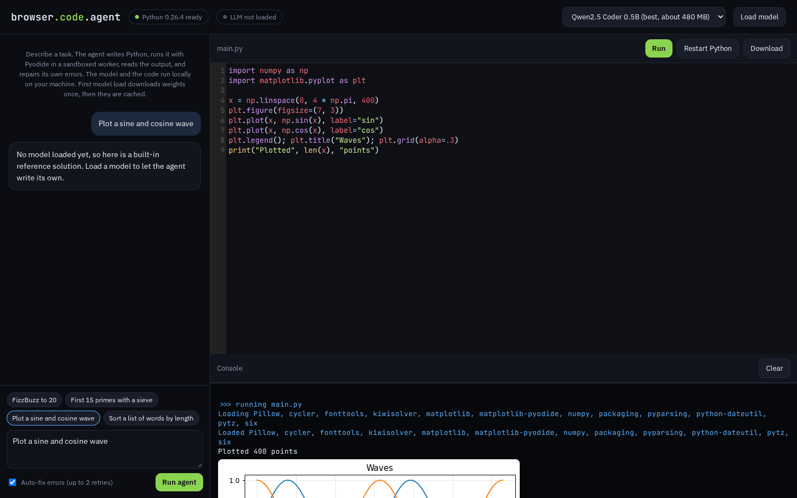

# Browser Code Agent

A coding agent that writes, runs and self-repairs Python entirely in your browser, using Pyodide and a small local LLM through transformers.js.

**Live demo:** https://josephbepocode.github.io/browser-code-agent/



## Features

- **Agent loop:** you describe a task, the local LLM writes a program, it runs in Pyodide, and on error the traceback is fed back so the model fixes its own code (up to 2 retries).
- **Local LLM:** Qwen2.5 Coder 0.5B Instruct (default) or SmolLM2 360M Instruct, 4-bit ONNX weights via transformers.js. Uses WebGPU when available, falls back to WebAssembly. Streaming tokens and a download progress bar. Weights are cached after the first load.
- **Python runtime:** Pyodide 0.26 (CPython 3.12) in a Web Worker, auto-loads packages from imports (numpy, pandas, matplotlib...), renders matplotlib figures inline, 20 second timeout to stop runaway loops, restartable.
- **Editor:** CodeMirror with Python highlighting, Ctrl/Cmd+Enter to run, download as main.py.
- **Works before the model loads:** quick-start examples include reference solutions, so the editor and runtime can be tried immediately.

## Tech

Pyodide 0.26.4, @huggingface/transformers 3.5.2 (ONNX Runtime Web), CodeMirror 5, Web Workers.

Fully static: no server, no API keys, no paid services. Hosted on GitHub Pages.

## Run locally

```bash
git clone https://github.com/josephbepocode/browser-code-agent.git
cd browser-code-agent
python3 -m http.server 8000
# open http://localhost:8000
```

## Notes and limitations

The first model download is large (about 480 MB for Qwen2.5 Coder, about 260 MB for SmolLM2). Small models are good at short scripts, not large programs. On CPU-only (WASM) machines generation is slow; a WebGPU browser such as recent Chrome or Edge is recommended. No network or local file access from Python.

## License

MIT, built by Deji ([@josephbepocode](https://github.com/josephbepocode)).
